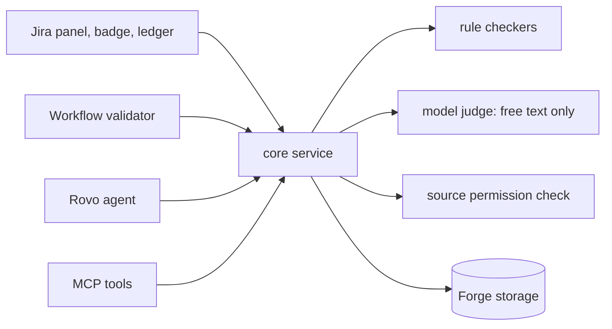

# Precedent

**Decisions your agents cannot ignore: tracked, checked, enforced.**

[](https://github.com/harshkumarsingh12/precedent/actions/workflows/ci.yml)
[](LICENSE)

Precedent is an Atlassian Forge app for [Codegeist 2026](https://codegeist2026.devpost.com) (Apps for Software
Teams). It records the decisions a team has already made, checks new Jira work items, specs and coding-agent plans
against them, and blocks work that contradicts one until a person resolves the conflict.

> **Status:** in development. Build started 28 Nov 2026; feature freeze 14 Dec; submission 20 Dec.
> The burndown of unbuilt acceptance criteria is in the summary of every [`ci` run](https://github.com/harshkumarsingh12/precedent/actions/workflows/ci.yml).

## The problem

Teams settle questions ("no customer emails in logs", "all public APIs live under /v2", "payments go through the
gateway service") and then lose them in comments, pages and pull requests. In 2026, Jira work items are assigned
straight to coding agents, which read the ticket, not the six-month-old thread where the team agreed the rule.
Existing tools give agents more context or measure what they did. None records a decision as a binding object and
checks new work against it.

## What it does

|                  |                                                                                                                                                                                                                                                                                      |
| ---------------- | ------------------------------------------------------------------------------------------------------------------------------------------------------------------------------------------------------------------------------------------------------------------------------------ |
| **Capture**      | Record a decision from any work item, or let Precedent propose one from a Jira comment ("we decided…"). A decision is binding only after an approver for its scope confirms it.                                                                                                      |
| **Check**        | Every create or edit of a work item in scope is checked. Typed decisions (tech choice, data policy, API convention, process rule) run deterministic checkers; only free-text decisions go to a model. Three verdicts: conflict, ok, inconclusive.                                    |
| **Enforce**      | A Jira workflow validator blocks a guarded transition while a conflict is open.                                                                                                                                                                                                      |
| **Serve agents** | A Rovo agent answers "why do we do X?" with cited decisions. Four MCP tools (`get_decisions`, `check_proposal`, `record_decision`, `export_agent_rules`) let Rovo Studio agents and coding agents read the rules, keep the marked block in `AGENTS.md` current and check their diff. |

**Precedence rule.** An accepted decision outranks ticket or page text; a superseding decision outranks the one it
replaced; expired and superseded decisions are history and never enforced.

## Architecture

One Forge app (Jira required, Confluence optional). Every surface calls the same core service, so permissions and
verdicts are identical in Jira, in Rovo chat and over MCP. Details: [docs/ARCHITECTURE.md](docs/ARCHITECTURE.md).



## Repository

```
manifest.yml            Forge modules: issue panel, badge, ledger, setup page, validator, triggers,
                        queues, Rovo agent, actions, rovo:mcp, llm
src/core/contract.ts    the frozen contract every surface uses
src/core/               the core service
src/{rules,ai,capture,guard,permissions,actions,seed}/
src/frontend/           UI Kit screens
skills/precedent/       the open-source skill file for coding agents
eval/                   labelled fixtures and the script that produces the published numbers
docs/                   project document, specs, roadmap, setup, judge instructions
```

## Getting started

```bash
bun install
bun run test && bun run ledger
```

Forge login, registration, the development site and deploys: [docs/SETUP.md](docs/SETUP.md).
Judges: [docs/JUDGE_TESTING.md](docs/JUDGE_TESTING.md).

## Evaluation

Precision and recall on at least 100 labelled cases, measured on a held-out set frozen before the final run, with
counts of false blocks, missed conflicts and inconclusive results. Published here before submission.

## Honest limits

- The workflow validator must be added to a transition by a Jira admin (the setup page has a guide).
- Pull request checks run through the coding agent's MCP call and are advisory; there is no Bitbucket merge check.
- External MCP clients need an admin to enable them under Connected apps.

## Team

Harsh Kumar Singh ([@harshkumarsingh12](https://github.com/harshkumarsingh12)) ·
Sristee Shrivastava ([@srshriv](https://github.com/srshriv)) ·
Sikruti Mahapatra ([@hoursgotviral-dev](https://github.com/hoursgotviral-dev)) ·
Sumedha ([@sumedhag28](https://github.com/sumedhag28))

Contributing: [CONTRIBUTING.md](CONTRIBUTING.md) · Conduct: [CODE_OF_CONDUCT.md](CODE_OF_CONDUCT.md) ·
Security: [SECURITY.md](SECURITY.md) · License: [Apache-2.0](LICENSE)
