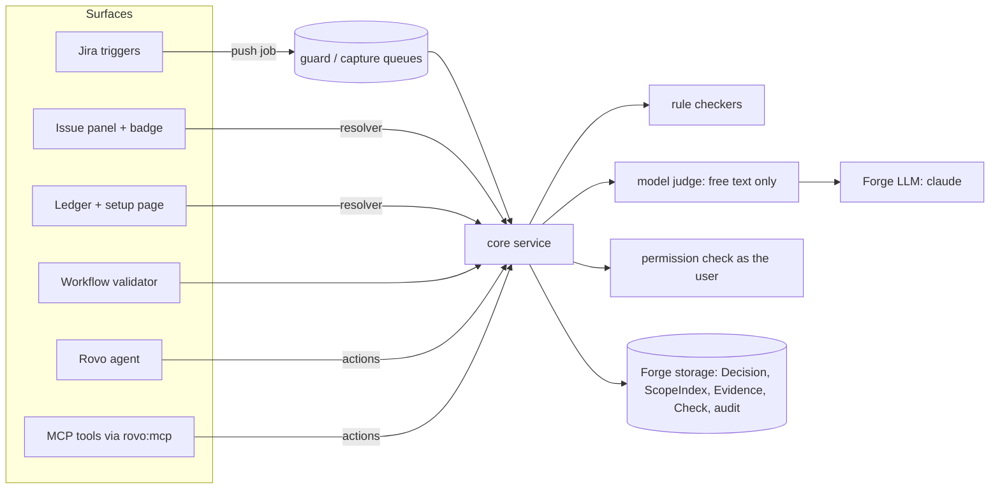

# Architecture

Precedent is one Forge app in which every surface calls the same core service, so permissions and verdicts are
identical in Jira, in Rovo chat and over MCP.

## Components

| Component           | Path                     | Responsibility                                                                                      | Spec       |
| ------------------- | ------------------------ | --------------------------------------------------------------------------------------------------- | ---------- |
| Triggers and queues | `src/triggers.ts`        | React to Jira events; push guard and capture jobs so model calls run outside the trigger time limit | 0003, 0004 |
| UI resolvers        | `src/resolver.ts`        | Serve the panel, badge, ledger and setup page                                                       | 0008       |
| Workflow validator  | `src/guard/validator.ts` | Block a guarded transition while a conflict is open; no model call                                  | 0005       |
| Core service        | `src/core/`              | The only code that reads or writes decisions and checks                                             | 0002       |
| Rule checkers       | `src/rules/`             | Deterministic checks for typed decisions, on text and on diffs                                      | 0004       |
| Model client        | `src/ai/`                | Extraction, rule proposal and contradiction judging, schema-validated                               | 0009       |
| Actions             | `src/actions/`           | Rovo and MCP entry points; validate inputs; identity from context                                   | 0006       |
| Permissions         | `src/permissions/`       | Source access checks and cache                                                                      | 0007       |
| Sample workspace    | `src/seed/`              | Northwind Payments demo project                                                                     | 0010       |
| UI                  | `src/frontend/`          | UI Kit screens (`render: native`)                                                                   | 0008       |

## Three request flows

**A spec conflicts with a decision.** PM edits a work item → `avi:jira:updated:issue` → trigger computes the
freshness key (text, scope, decision revisions) and queues a guard job if it changed → guard resolves scope keys,
loads accepted decisions, runs rule checkers, batches free-text decisions to the judge → writes Check rows with a
sequence number (older results are discarded) → the panel shows the conflict card.

**A coding agent starts work.** Agent (following `SKILL.md`) calls `get_decisions` over MCP → action handler takes
the user from the context → core filters by source access and repository publication approval → before opening a
PR the agent calls `check_proposal` with its diff → rule checkers return an advisory verdict with evidence.

**Someone moves a conflicting work item.** Jira calls the validator with the issue key → validator calls
`getIssueState` (no model call) → if the stored freshness key no longer matches, rule checkers run inline and
model checks are queued → an open conflict returns `result: false` with a message rendered for the viewer.

## Data

Forge custom entities, scoped to the installation (`storage:app`). Every lookup has an index.

| Entity      | Key fields                                                                               | Indexes                          |
| ----------- | ---------------------------------------------------------------------------------------- | -------------------------------- |
| decision    | id `DEC-<n>`, statement, kind, rule, status, ownerAccountId, scopeKeys, revision, source | status; owner+status; updatedAt  |
| scope-index | scopeKey, decisionId, status                                                             | scopeKey+status                  |
| evidence    | decisionId, sourceRef, quote                                                             | decisionId                       |
| check       | targetRef, decisionId, freshness, sequence, verdict, resolution                          | targetRef+resolution; decisionId |

Plain keys: `counter:decision`, `config:scopes`, `config:guard`, `config:approvers`, `usage:<yyyy-mm-dd>`,
`audit:<timestamp>:<id>`.

The types are in [`src/core/contract.ts`](../src/core/contract.ts).
